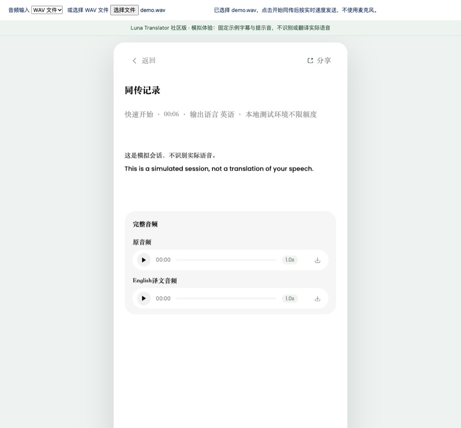
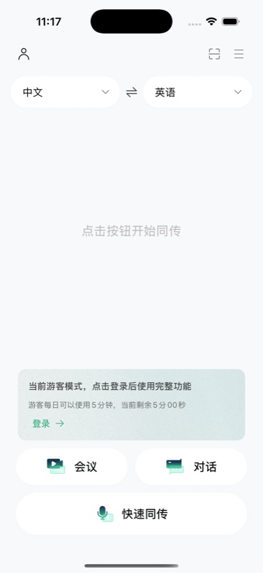
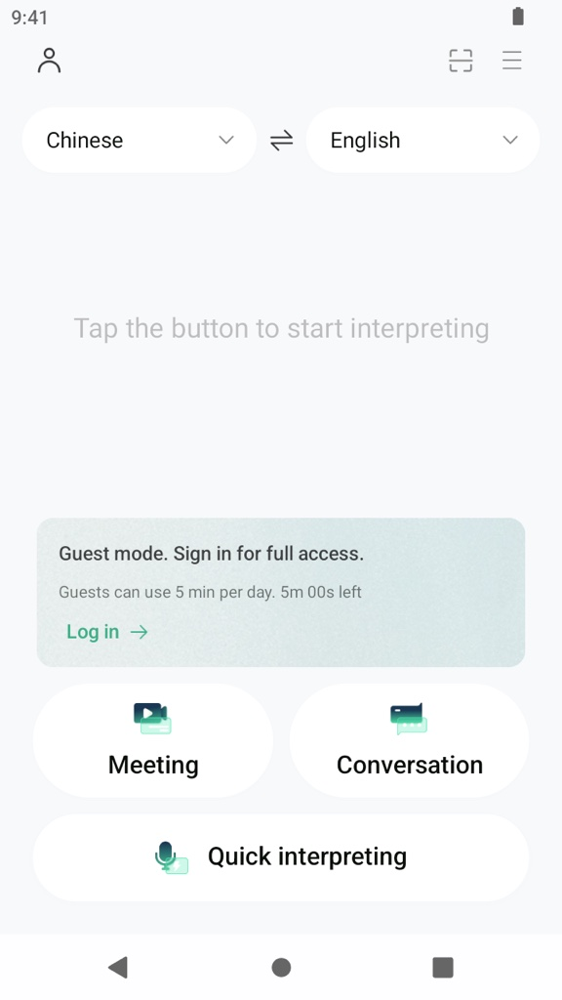

<p align="center">
  
</p>

<h1 align="center">Luna Translator</h1>

<p align="center">
  VUI Labs 的实时语音同传开源应用与 API 解决方案，提供实时字幕和译音，现已开源 Web 与 iOS 社区版。
</p>

<!-- rankings:hero:start -->
<!-- 由 scripts/readme-badges.mjs 生成，请修改 docs/rankings.json 后重新运行 -->
<p align="center">
  <a href="https://trendshift.io/?language=TypeScript"><picture><source media="(prefers-color-scheme: dark)" srcset="docs/assets/badges/trending-dark.svg" /></picture></a>
  <a href="#榜单记录"><picture><source media="(prefers-color-scheme: dark)" srcset="docs/assets/badges/topics-dark.svg" /></picture></a>
</p>
<!-- rankings:hero:end -->

<p align="center">
  <a href="https://github.com/VUILabsAI/Luna-Translator/stargazers"></a>
  <a href="https://github.com/VUILabsAI/Luna-Translator/releases/latest"></a>
  <a href="#安装与快速开始"></a>
</p>

<p align="center">
  中文 · <a href="README.en.md">English</a>
</p>

<p align="center">
  <a href="https://simultrans.lunalabs.cn/"><picture><source media="(prefers-color-scheme: dark)" srcset="docs/assets/badges/cta-try-dark.svg" /></picture></a>
  <a href="examples/quickstart/README.md"><picture><source media="(prefers-color-scheme: dark)" srcset="docs/assets/badges/cta-api-dark.svg" /></picture></a>
  <br />
  <a href="#安装与快速开始">自托管社区版</a> · <a href="ios/README.md">iOS 源码与构建</a> · <a href="solutions/README.md">按场景接入</a> · <a href="https://doc.vuilabs.cn/api-reference/realtime-interpretation/">同传 v3 API 文档</a> · <a href="#官方网页版与产品介绍">官方网页版</a>
</p>

## 边说，边译，边听

*in Real-time, one voice, every language.*

听一场外语分享，向不同语言的听众介绍想法，或与面前的人轮流交谈——Luna Translator 将输入语音转换为原文字幕、目标语言译文与译音，并保留会话，方便之后回听和分享。

这个仓库提供自托管 **Web 前端、Go 后端和 iOS 社区客户端**。Web 和 iOS 可以连接同一个工作区。应用通过外部 API 完成实际识别与翻译，本机部署无需 GPU。

## 仓库规划

仓库提供开源客户端和自托管后端，也将逐步开源面向不同场景的同声传译解决方案，包括接入示例、配置说明和验证方法。

### 客户端开源

| 客户端 | 状态 | 社区版范围 |
|---|---|---|
| Web | **已开源** | 单人同传、中英双向对话、历史、回放与分享。查看 [Web 源码](web/) 或 [自托管指南](#安装与快速开始)。 |
| iOS | **已开源** | 首批提供单人快速同传、麦克风收音、实时字幕和译音播放。查看 [iOS 源码](ios/) 或 [Xcode 构建指南](ios/README.md)。 |
| Android | **下一阶段** | 计划先开放快速同传社区版，实现自托管连接，并验证模拟器和真机的录音、字幕与译音。 |
| macOS | **后续计划** | 计划开放桌面同传社区版，完成独立构建、麦克风权限及音频输出验证后发布源码。 |

Web 和 iOS 都可以在模拟模式下运行。真实识别与翻译需要在社区后端配置模型服务。

### 同声传译场景规划

| 场景 | 当前可用范围 | 计划开源内容 |
|---|---|---|
| [面对面对话](#从实时交流到回听分享) | Web 支持中英双方在同一设备轮流发言。 | 发布独立的双向对话示例，演示发言方切换、双语字幕与译音播放。 |
| [直播同传（OBS）](solutions/livestream/README.md) | 提供单路音频同传链路与 OBS 接入参考。 | 发布 OBS 字幕叠加、独立译音轨道的接入示例和配置说明。 |
| [会议同传](solutions/meeting/README.md) | Web 可处理单路主讲人音轨，仓库提供多人会议参考架构。 | 发布多人会议接入示例，演示音轨接入及按听众语言分发字幕和译音。 |
| [听课与讲座](solutions/classroom/README.md) | 已有可运行的 Go v3 示例、讲座音频与真实翻译验收记录。 | 补充适用于课堂和讲座的一对多接入示例。 |
| [通话同传](solutions/calls/README.md) | 已有双路通话接入的参考架构。 | 发布双路音轨的接入示例，演示字幕与译音如何路由至通话双方。 |

[客户端详细计划](docs/open-source-plan.md#c-端开源计划) · [现有场景指南](solutions/README.md)

## 社区版演示

[](docs/assets/community-web-demo.mp4)

[观看 Web 社区版录屏（MP4）](docs/assets/community-web-demo.mp4)：用 WAV 输入启动模拟同传，查看字幕和保存的会话。示例字幕由模拟模式生成，不是对输入内容的实际翻译。

## 最新动态

- **2026-11-27 · main** · 社区 Web 修复原文识别重连后字幕停止更新的问题，Welcome 页更新简繁品牌名。Go 后端的 Luna Bearer 适配器改用结构化术语词对，VAD 默认关闭。[模型配置与协议](docs/providers.md)
- **2026-11-24 · [v0.1.2](https://github.com/VUILabsAI/Luna-Translator/releases/tag/v0.1.2)** · 参考 iOS 1.0.11（131）与 Android 87 的历史加载优化，社区 Web 先显示服务端已有记录，在后台补存并刷新列表。历史详情可重新检查暂缺的音轨，保留已可播放的音频。晚到的浏览器检查点不会覆盖已完成的记录。社区 Web 沿用 iOS 1.0.11（128）的界面样式。
- **2026-11-23 · [v0.1.1](https://github.com/VUILabsAI/Luna-Translator/releases/tag/v0.1.1)** · 新增四个双语场景指南和 Go Quickstart。听课示例附带真实中译英的译文和译音。公开发行包已通过干净环境的 Docker Compose 启动、WAV 输入和浏览器回放验收。[验收记录](docs/validation.md#v011)
- **2026-10-30 · [v0.1.0](https://github.com/VUILabsAI/Luna-Translator/releases/tag/v0.1.0)**：发布首个 Web + Go 后端社区版，提供 Docker Compose 启动、Luna / 百炼适配、历史与音频归档、可撤销分享，以及独立的公开 CI。

## 从实时交流，到回听分享

| 场景 | 如何使用 |
|---|---|
| 单人同传 | 选择输入和目标语言，查看原译文并播放译音；一次最多选择 3 种目标语言。 |
| 面对面对话 | 中英双方轮流发言，切换当前发言方，上下两侧分别查看对应语言字幕。 |
| 会后回听 | 打开历史，查看已保存文字，播放或下载原音与译音 WAV。 |
| 分享记录 | 为历史生成限时快照链接，接收者无需工作区密码即可查看；可随时撤销。 |
| 开发与联调 | 无模型密钥时走模拟流程，也可用 PCM16 WAV 按实时速度复现同传链路。 |

### 核心能力

- **实时字幕与译音**：支持中文 / 英文输入；目标语言由 Luna 公共 API 提供，最多同时输出 3 种。
- **单人和双向交互**：快速开始或中英轮流对话，保留双方的文字与音轨。
- **完整会话记录**：本地数据卷持久保存历史与音频，支持浏览、回放、下载和删除。
- **可撤销分享**：生成最长 30 天的分享快照；撤销链接或删除原记录后，链接失效。
- **可扩展服务接入**：通过应用层适配器调用 Luna 同传、百炼 ASR 与 Embedding。
- **独立部署**：两个容器、一个数据卷、自动生成工作区密码，无需外部数据库或短信平台。

## 参考架构


模型凭据保留在后端。浏览器负责采集和播放，后端负责服务编排与数据保存。完整接口和数据生命周期见 [架构说明](docs/architecture.md) 与 [服务协议](docs/providers.md)。

## 安装与快速开始

> 社区版可在本机运行模拟体验，无需模型 API Key。只需要调用 API 时，可以直接看 [Go API 快速开始](examples/quickstart/README.md)：示例直连国内同传 v3，使用 `X-API-Key`。社区版通过 [Bearer 模型适配器](docs/providers.md#luna-公共-api)接入自己的模型服务。

### 1. 下载项目

安装 [Docker Engine / Docker Desktop 与 Compose](https://docs.docker.com/compose/install/)，然后克隆仓库：

```sh
git clone https://github.com/VUILabsAI/Luna-Translator.git
cd Luna-Translator
```

也可以从 [Releases](https://github.com/VUILabsAI/Luna-Translator/releases) 下载 ZIP 或 tar.gz 并解压；同页提供 SHA-256 校验文件。

### 2. 一条命令启动

macOS / Linux：

```sh
sh ./start.sh
```

Windows PowerShell：

```powershell
./start.ps1
```

脚本会构建 Web 与后端镜像、等待健康检查，并显示本部署的工作区密码。打开 <http://localhost:8088> 登录，即可体验。

首次构建需要访问公开镜像及 npm / Go 依赖源；Docker 部署无需本机安装 Node.js 或 Go。需要自定义端口、远程 HTTPS、备份或升级时，参见 [部署指南](docs/deployment.md)。

> **默认模拟模式**只显示固定示例字幕和提示音，不会识别或翻译实际语音。模拟音频进入本机后端；接入真实服务后，音频才会发送给所配置的提供方。

### 3. 试用一次会话

选择输入和输出语言，点击「开始同传」，完成音频授权后开始说话。也可先选择无压缩 PCM16 WAV，按实时速度发送测试音频。会话完成后，可以查看历史、回放音频或生成分享链接；面对面交流时切换「对话」模式。

## 接入模型服务

各项能力可以按需配置：

| 能力 | 推荐服务 | 接入准备 | 在社区版中的用途 |
|---|---|---|---|
| 同传 | [Luna 公共 API](https://simultrans.lunalabs.cn/api-docs) | Luna API Key | 实时译文与合成语音；固定音色，默认不开启声音克隆。 |
| 原文识别 | [百炼 `qwen3-asr-flash-realtime`](https://help.aliyun.com/zh/model-studio/real-time-speech-recognition-user-guide) | API Key、工作空间与地域 | 为 Luna 链路补充原文字幕。 |
| 向量评分 | [百炼 `text-embedding-v4`](https://help.aliyun.com/zh/model-studio/text-embedding-synchronous-api) | API Key 与 Embedding 完整接口地址 | 通过后端接口计算整段原译文相似度，供开发者调用与扩展。 |

先复制配置示例（macOS / Linux 使用 `cp .env.example .env`；PowerShell 使用 `Copy-Item .env.example .env`），再编辑 `.env`：

```dotenv
# 开启真实同传；只配置 Luna 时即可获得译文和译音。
DEMO_MODE=false
LUNA_API_KEY=your-own-luna-key

# 可选：补充原文识别。
DASHSCOPE_API_KEY=your-own-model-studio-key
DASHSCOPE_WORKSPACE_ID=your-workspace-id
DASHSCOPE_REGION=cn-beijing

# 可选：启用向量评分接口，地址以自己的工作空间配置为准。
DASHSCOPE_EMBEDDING_URL=https://your-workspace-id.cn-beijing.maas.aliyuncs.com/compatible-mode/v1/embeddings
```

重新运行启动脚本以应用配置。Luna Bearer 链路默认关闭 VAD，使用 `LUNA_ENABLE_VAD` 和 `LUNA_HOTWORDS` 可选配置 VAD 与术语词对。详见[热词与 VAD](docs/providers.md#热词与-vad)。未配置百炼 ASR 时，Luna 译文和译音仍可使用，原文字幕不可用。服务开通、费用、地域和并发限制由各提供方决定；多个目标语言会分别建立上游调用并占用额度。

社区版按整段或每轮发言展示原译文。Embedding 提供向量评分，不能代替已验证的逐句对齐模型。更多参数和适配方式见 [模型配置与协议](docs/providers.md)。自己的 `.env` 和密钥应留在本机，不提交到仓库或公开 Issue。

## 本地开发

需要 **Node.js 22.12+、Go 1.26.10+**。在仓库根目录安装依赖：

```sh
npm ci
```

macOS / Linux 在一个终端启动模拟后端：

```sh
DATA_DIR="$PWD/data" DEMO_MODE=true go -C backend run .
```

在另一个终端启动前端：

```sh
npm run dev --workspace web
```

打开 <http://localhost:5173>。首次生成的工作区密码位于 `data/admin-password`；前端通过 Vite 代理连接本机 `8080` 后端。

构建与检查：

```sh
npm run build
npm test
go -C backend test -race ./...
python3 scripts/check-public-content.py
```

| 目录 | 内容 |
|---|---|
| `web/` | Web 页面、音频交互、历史与分享界面。 |
| [`ios/`](ios/README.md) | SwiftUI 客户端、原生音频和模拟器测试。 |
| `packages/core/`、`packages/ui-shared/` | 共享文本状态、协议与浏览器音频逻辑。 |
| `backend/community/` | 独立工作区 API、会话编排与持久化。 |
| `backend/providers/` | 外部模型服务客户端适配器。 |
| [`solutions/`](solutions/README.md) | 会议、听课、直播和通话的场景指南与接入范围。 |
| [`examples/quickstart/`](examples/quickstart/README.md) | 可运行的国内同传 v3 Go 示例。 |
| `docs/` | 架构、部署、服务接入、验收与路线图。 |

## 版本范围与路线图

社区版面向**单工作区部署**。使用同一部署密码的人共享历史与模型额度。不同用户需要独立部署，远程浏览器麦克风需要有效 HTTPS。

已完成真实合成语音的中译英 / 英译中、浏览器历史与分享、容器启动和公开 CI 验证。真人麦克风、耳机 / 回声、Safari / Edge、Windows 实机及长会话负载尚未完成验收，具体记录见 [验证说明](docs/validation.md)。

后续继续验证 iOS 实机录音、译音和真实模型，并改进 Web 兼容性、可访问性与模型适配。客户端与同传场景的开源安排见 [仓库规划](#仓库规划)。

## 官方网页版与产品介绍

| 地区 | 产品介绍（Welcome） | 官方网页版 |
|---|---|---|
| 中国大陆 | [大陆产品页](https://simultrans.lunalabs.cn/welcome/) | [打开大陆网页版](https://simultrans.lunalabs.cn/) |
| 国际通用入口 | [国际产品页（英文）](https://simultrans.vuilabs.ai/welcome/?lang=en) | [打开国际网页版](https://simultrans.vuilabs.ai/) |
| 美国（北美） | [北美产品页（英文）](https://simultrans.vuilabs.ai/us/welcome/?lang=en) | [打开北美网页版](https://simultrans.vuilabs.ai/us/) |

官方网页版与独立部署的社区工作区使用各自的账号和数据。国际和北美网页版需要先登录。官方 API 的能力和协议另见[国内同传 API 文档](https://doc.vuilabs.cn/api-reference/realtime-interpretation/)。

### 官方移动端预览

<p>
  
  
</p>

上图为官方 iOS 和 Android App 的模拟器预览，Android 截图来自 1.0.11（90）构建。中国大陆用户可在 [App Store](https://apps.apple.com/cn/app/id6806330215) 下载官方 iOS App。自托管版本的运行说明和界面截图见 [iOS 社区版指南](ios/README.md)。

## FAQ 与排障

- **没有 API Key 能运行吗？** 可以。默认模拟模式无需模型凭据，可体验字幕、历史和分享流程；真实翻译见[模型接入](#接入模型服务)。
- **启动失败或端口被占用？** 用 `docker compose logs` 查日志，必要时在 `.env` 中修改 `PORT`。更多问题见[部署排障](docs/deployment.md#常见问题)。
- **无法使用麦克风？** 检查浏览器权限；远程访问需要 HTTPS。也可选择无压缩 PCM16 WAV 文件测试。

## 项目状态

<p>
  <a href="https://github.com/VUILabsAI/Luna-Translator/actions/workflows/ci.yml"></a>
  <a href="LICENSE"></a>
  
</p>

### 榜单记录

<!-- rankings:records:start -->
<!-- 由 scripts/readme-badges.mjs 生成，请修改 docs/rankings.json 后重新运行 -->

每个榜单展示已核验的历史最佳。按名次从高到低排列，同名次优先展示全站榜，再按获得时间从新到旧。GitHub 主题按累计 Star 排序。

| 名次 | 获得时间（UTC） | 徽章 | 说明 |
|---:|---|---|---|
| **#1** | 2026-11-28 05:01:00 | <a href="https://github.com/topics/simultaneous-translation?o=desc&amp;s=stars"><picture><source media="(prefers-color-scheme: dark)" srcset="docs/assets/badges/rankings/topic-stars-simultaneous-translation-1-dark.svg" /></picture></a> | GitHub 主题 · simultaneous-translation |
| **#1** | 2026-11-28 00:05:41 | <a href="https://github.com/topics/real-time-translation?o=desc&amp;s=stars"><picture><source media="(prefers-color-scheme: dark)" srcset="docs/assets/badges/rankings/topic-stars-real-time-translation-1-dark.svg" /></picture></a> | GitHub 主题 · real-time-translation |
| **#1** | 2026-11-27 01:33:34 | <a href="https://trendshift.io/?language=TypeScript"><picture><source media="(prefers-color-scheme: dark)" srcset="docs/assets/badges/rankings/trendshift-daily-typescript-1-dark.svg" /></picture></a> | Trendshift 日榜 · TypeScript |
| **#1** | 2026-11-26 08:45:54 | <a href="https://github.com/topics/speech-to-speech-translation?o=desc&amp;s=stars"><picture><source media="(prefers-color-scheme: dark)" srcset="docs/assets/badges/rankings/topic-stars-speech-to-speech-translation-1-dark.svg" /></picture></a> | GitHub 主题 · speech-to-speech-translation |
| **#2** | 2026-11-27 01:51:46 | <a href="https://trendshift.io/"><picture><source media="(prefers-color-scheme: dark)" srcset="docs/assets/badges/rankings/trendshift-daily-all-2-dark.svg" /></picture></a> | Trendshift 日榜 · 全语言 |
| **#2** | 2026-11-28 05:00:58 | <a href="https://github.com/topics/live-translation?o=desc&amp;s=stars"><picture><source media="(prefers-color-scheme: dark)" srcset="docs/assets/badges/rankings/topic-stars-live-translation-2-dark.svg" /></picture></a> | GitHub 主题 · live-translation |
| **#2** | 2026-11-28 00:05:40 | <a href="https://github.com/topics/live-captions?o=desc&amp;s=stars"><picture><source media="(prefers-color-scheme: dark)" srcset="docs/assets/badges/rankings/topic-stars-live-captions-2-dark.svg" /></picture></a> | GitHub 主题 · live-captions |
| **#3** | 2026-11-26 | <a href="https://github.com/topics/simultaneous-interpretation?o=desc&amp;s=stars"><picture><source media="(prefers-color-scheme: dark)" srcset="docs/assets/badges/rankings/topic-stars-simultaneous-interpretation-3-dark.svg" /></picture></a> | GitHub 主题 · simultaneous-interpretation |
| **#7** | 2026-11-28 05:01:03 | <a href="https://github.com/topics/speech-translation?o=desc&amp;s=stars"><picture><source media="(prefers-color-scheme: dark)" srcset="docs/assets/badges/rankings/topic-stars-speech-translation-7-dark.svg" /></picture></a> | GitHub 主题 · speech-translation |
| **#22** | 2026-11-28 05:40:20 | <a href="https://trendshift.io/weekly?language=TypeScript"><picture><source media="(prefers-color-scheme: dark)" srcset="docs/assets/badges/rankings/trendshift-weekly-typescript-22-dark.svg" /></picture></a> | Trendshift 周榜 · TypeScript |

数据来自 [docs/rankings.json](docs/rankings.json)。[榜单维护](docs/rankings.md)
<!-- rankings:records:end -->

## 交流与贡献

欢迎通过 [Issues](https://github.com/VUILabsAI/Luna-Translator/issues) 反馈问题、讨论场景和提出功能建议，也欢迎提交 Pull Request。当前适合参与的方向包括浏览器兼容、无障碍、模型适配、文档与对齐策略。

- [贡献指南](CONTRIBUTING.md)：开发检查与提交说明。
- [安全报告](SECURITY.md)：私有凭据、录音及安全问题的报告方式。
- [第三方声明](THIRD_PARTY_NOTICES.md)：依赖、字体与素材许可。

## 许可证

应用代码采用 [Apache License 2.0](LICENSE)，第三方组件遵循各自许可。本仓库不分发 ASR、同传、Embedding 对齐等模型的权重、训练代码、训练数据或内部模型推理实现；模型服务的使用条件由提供方规定。
