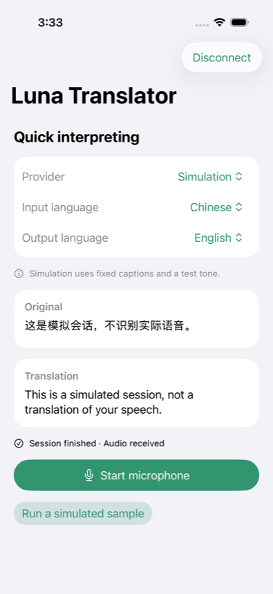

# Luna Translator for iOS

[中文](README.md) · [Repository home](../README.en.md)

A SwiftUI and native audio client for a self-hosted Luna Translator workspace. The first source release covers workspace sign-in, language selection, microphone capture, live captions, and playback for Quick Interpreting. It uses the Luna iOS 1.0.11 (128) palette and Quick Interpreting layout, with PCM conversion adapted from the product client.



## Run in the simulator

1. Run `./start.sh` from the repository root and note the workspace password it displays.
2. Open [LunaCommunity.xcodeproj](LunaCommunity.xcodeproj/project.pbxproj) in Xcode 26 or later. Select the `LunaCommunity` scheme and an iPhone simulator running iOS 17 or later, then click **Run**.
3. Enter `http://localhost:8088` as the workspace address, or use the port you configured. Enter the workspace password and connect.
4. Select **Simulation** and tap **Run a simulated sample**. The app sends a silent sample, receives fixed Chinese and English captions, and plays a test tone. This flow uses neither microphone permission nor a model API key.

To build for the simulator without signing, run this from the repository root:

```sh
xcodebuild -project ios/LunaCommunity.xcodeproj -scheme LunaCommunity \
  -destination 'generic/platform=iOS Simulator' CODE_SIGNING_ALLOWED=NO build
```

## Connect your workspace

For a physical device, select your own signing team and bundle ID in Xcode, then enter a workspace address with valid HTTPS. To try live translation, [configure a model provider](../docs/providers.md) in the Go backend, then select an available provider and output language in the app. Tap **Start microphone** and grant access. **End microphone input** lets the server finish sending captions and audio. The workspace password and access token are kept in memory, and model credentials stay in the backend. The server can archive audio. See [architecture and data](../docs/architecture.md) for storage details.

The current scope is solo Quick Interpreting with one output language. Turn-taking, multi-party meetings, mobile history and replay, and official account features are outside this first release. The [App Store app](https://apps.apple.com/cn/app/id6806330215) uses the official service and accounts.

## Tests

`LunaCommunityUITests` checks captions, audio delivery, and completion in two consecutive sessions. It also exercises microphone capture and stop on the simulator. These commands start a dedicated local test workspace.

```sh
ADMIN_PASSWORD=luna-local-demo DEMO_MODE=true docker compose -p luna-ios-qa up --build --wait
xcodebuild -project ios/LunaCommunity.xcodeproj -scheme LunaCommunity \
  -destination 'platform=iOS Simulator,name=iPhone 17 Pro' \
  -parallel-testing-enabled NO test
docker compose -p luna-ios-qa down
```
