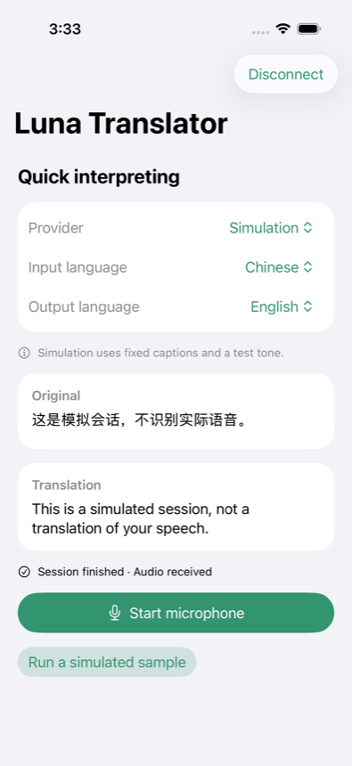

# Luna Translator iOS 社区版

[English](README.en.md) · [仓库首页](../README.md)

使用 SwiftUI 和原生音频连接自托管的 Luna Translator 工作区。首批公开「快速同传」所需的工作区登录、语言选择、麦克风采集、实时字幕与译音播放。界面采用 Luna iOS 1.0.11（128）的品牌色和快速同传布局，音频采集沿用产品 iOS 客户端的 PCM 转换逻辑。



## 在模拟器运行

1. 在仓库根目录运行 `./start.sh`，记下显示的工作区密码。
2. 在 Xcode 中打开 [LunaCommunity.xcodeproj](LunaCommunity.xcodeproj/project.pbxproj)，选择 `LunaCommunity` scheme 和 iOS 17 或更新版本的 iPhone 模拟器，按 **Run**。构建需要 Xcode 26 或更新版本。
3. 工作区地址用 `http://localhost:8088`。如修改过端口，请填实际地址。输入工作区密码并连接。
4. 选择「模拟体验」，点击「运行模拟示例」。应用发送静音样本，接收固定的中英文字幕并播放测试音，全程无需麦克风权限或模型 API Key。

也可在仓库根目录执行无签名的模拟器构建：

```sh
xcodebuild -project ios/LunaCommunity.xcodeproj -scheme LunaCommunity \
  -destination 'generic/platform=iOS Simulator' CODE_SIGNING_ALLOWED=NO build
```

## 接入自己的工作区

实机运行时，在 Xcode 中选择自己的签名团队及 Bundle ID，并填写有效的 HTTPS 工作区地址。要试真实翻译，请先在 Go 后端[配置模型服务](../docs/providers.md)，再在 App 中选择可用提供方和目标语言。点击「开始收音」并允许麦克风权限，「结束收音」会等待末尾译文和音频。工作区密码和访问令牌只在内存中使用，模型凭据由后端保管。服务端可以归档音频，有关保存和清理方式请见[架构说明](../docs/architecture.md)。

当前公开范围为单人、单目标语言快速同传。双向对话、多人会议、移动端历史回放和官方账号功能属于后续范围。中国大陆 [App Store 版](https://apps.apple.com/cn/app/id6806330215) 使用官方服务和账号。

## 测试

`LunaCommunityUITests` 检查连续两轮模拟会话的原文、译文、音频和完成状态，也验证模拟器麦克风的开始和结束收音。以下命令为本地测试单独启动一个工作区。

```sh
ADMIN_PASSWORD=luna-local-demo DEMO_MODE=true docker compose -p luna-ios-qa up --build --wait
xcodebuild -project ios/LunaCommunity.xcodeproj -scheme LunaCommunity \
  -destination 'platform=iOS Simulator,name=iPhone 17 Pro' \
  -parallel-testing-enabled NO test
docker compose -p luna-ios-qa down
```
